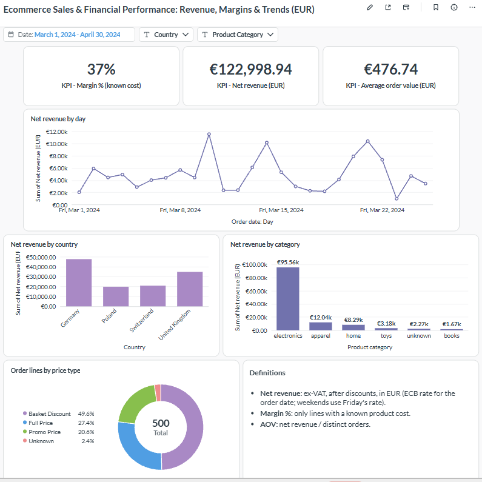
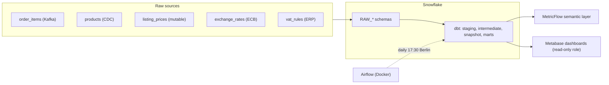
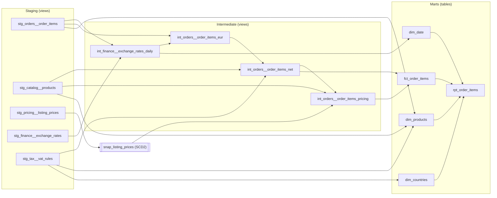

# European Retail Analytics & Financial Reporting Layer

# E-commerce Revenue & Margin Pipeline

**One net-revenue number across four markets (DE, UK, CH, PL): an end-to-end analytics engineering project with dbt, Snowflake, Airflow, MetricFlow and Metabase.**



> **Sample data:** 500 synthetic order lines for Germany, the United Kingdom, Switzerland and Poland, 1-25 March 2024. No real company data.

## The business problem

Local country managers report sales in their **local currency (EUR, GBP, CHF, PLN) including local taxes**. Berlin HQ reports everything in **EUR, net of VAT**. Prices change daily with promotions, exchange rates move constantly, and the two views drift apart by large amounts every month.

This project builds the data layer that makes both views agree: a single, tested definition of **net revenue and margin in EUR**, traceable from raw data to the dashboard.

## At a glance

- **5 raw sources** with different shapes: an event stream, CDC, a mutable table with no history, a weekday-only FX feed and a static VAT table.
- **5 staging, 4 intermediate and 6 mart models**, one SCD Type 2 snapshot, a star schema and a flat reporting table.
- **190+ automated checks:** data tests with explicit error/warn severity, custom singular tests and 12 unit tests on the trickiest business rules.
- **A semantic layer** (MetricFlow) with 10 governed metrics.
- **Orchestration** with Airflow (Docker), running the pipeline daily after the ECB publishes its rates.
- **Two Metabase dashboards** on a read-only role, with the data dictionary managed as code from dbt.
- **Reconciled end to end:** the same net revenue figure appears in Snowflake, MetricFlow and Metabase.

## Architecture



## Data lineage



## Tech stack

| Layer | Tools |
|---|---|
| Warehouse | Snowflake |
| Transformation | dbt Core 1.8, dbt-snowflake, `dbt_utils` |
| Semantic layer | MetricFlow (dbt-metricflow) |
| Orchestration | Apache Airflow 2.10 in Docker (Postgres, LocalExecutor) |
| BI | Metabase (Docker), `dbt-metabase` for the data dictionary |
| Quality | dbt data tests, singular tests, unit tests |
| Version control | Git, GitHub |

## Data model

| Layer | Models | Purpose |
|---|---|---|
| **Staging** | `stg_orders__order_items`, `stg_catalog__products`, `stg_pricing__listing_prices`, `stg_finance__exchange_rates`, `stg_tax__vat_rules` | rename, cast, clean strings. No business logic |
| **Snapshot** | `snap_listing_prices` | SCD Type 2 history of a table that overwrites in place at the source |
| **Intermediate** | `int_finance__exchange_rates_daily` | gapless daily FX rates (date spine, forward-fill) |
| | `int_orders__order_items_eur` | order lines converted to EUR |
| | `int_orders__order_items_net` | VAT time-travel join and net revenue |
| | `int_orders__order_items_pricing` | historical list price, discount depth, margin, price type |
| **Marts** | `fct_order_items` | fact table, one row per order line |
| | `dim_products`, `dim_countries`, `dim_date` | dimensions (star schema) |
| | `rpt_order_items` | flat table for BI tools |
| | `metricflow_time_spine` | calendar for the semantic layer |

## Key design decisions

1. **Net revenue is defined once:** `(gross - discount) / (1 + VAT rate)` in EUR, where gross and discount are tax-inclusive. Every report uses this definition.
2. **Exchange rates are gapless.** The ECB publishes weekdays only, so a date spine carries the last published rate over weekends and holidays. Each line records the rate's source date and a carried-forward flag. A non-EUR line with no rate stays `NULL` instead of silently defaulting to 1.0.
3. **VAT uses a time-travel join** on country, category and order date, so a rate change applies from the right day. A missing rule is treated as 0% and flagged. Revenue is never dropped.
4. **Price history is rebuilt with a snapshot.** The pricing service overwrites in place, so a snapshot keeps every version. Orders join to the version valid at order time using half-open windows `[valid_from, valid_to)`. Orders older than the first recorded version fall back to the earliest one and are flagged as a history gap.
5. **Known data gaps are flagged, not hidden.** Missing VAT rules, missing costs, unlisted products and orphan product IDs carry boolean flags into the marts and onto a data-quality dashboard.
6. **Orphan products don't lose revenue.** `dim_products` adds inferred members for product IDs that appear in orders but not in the catalog, so an inner join in a BI tool can't drop them.
7. **Margin is honest.** Lines without a known cost would show margin equal to revenue, so margin % is computed over known-cost lines only, in both the semantic layer and the dashboard.
8. **Tests encode severity.** Structural rules (keys, valid values, amounts) are errors. Known data gaps are warnings, with an expected count, so the build stays green while the problem stays visible.
9. **Business logic is unit-tested** with mocked inputs: weekend fill, VAT boundary dates, snapshot window edges, history-gap fallback and flag precedence.
10. **Least privilege for BI.** Metabase connects as a dedicated user whose role can only read the marts schema.
11. **Secrets stay out of Git.** Credentials live in `.env` files and `profiles.yml` outside the repository, and containers read them from environment variables.

## Edge cases covered (in the sample data)

| Edge case | Order lines |
|---|---|
| EUR orders (no FX row, rate 1.0) | 155 |
| Weekend orders (rate carried forward from the last published day) | 121 |
| Lines priced on a carried-forward FX rate (non-EUR) | 85 |
| `NULL` discount | 70 |
| No known product cost | 71 (50 `NULL` costs + 21 orphan products) |
| No matching VAT rule | 77 |
| Orphan product IDs (not in the catalog) | 21 |
| Orders before the first recorded price version (history gap) | 54 |
| CH VAT rate change on 2024-03-15 (synthetic, for time-travel testing) | 46 before, 27 after |

## Data quality

- **Data tests:** uniqueness, not-null, relationships, accepted values, reconciliation between models (for example, the fact table must match the net model row for row).
- **Singular tests:** VAT validity windows must not overlap, snapshot versions must not overlap, and the price version used must be valid at order time.
- **Unit tests (12):** mocked inputs for the date spine, EUR conversion, VAT and pricing logic.
- **Expected warnings:** the known gaps above (12 warnings in a full build, 0 errors).

## Reconciliation

| Figure | Snowflake | MetricFlow | Metabase |
|---|---|---|---|
| Net revenue (EUR) | 122,998.94 | 122,998.94 | 122,998.94 |
| Gross revenue (EUR) | 147,220.26 | 147,220.26 | |
| Margin (EUR) | 52,015.91 | 52,015.91 | |
| Average order value (EUR) | 476.74 | 476.74 | 476.74 |
| Margin % (known-cost lines) | 0.37 | 0.37 | 37% |

## Semantic layer

Ten metrics are defined once in dbt (MetricFlow) and queried by name:

`gross_revenue`, `net_revenue`, `total_discounts`, `vat_collected`, `margin`, `units_sold`, `total_orders`, `average_order_value`, `discount_rate`, `margin_pct`

```powershell
mf query --metrics net_revenue,average_order_value --group-by product__category
mf query --metrics net_revenue --group-by metric_time__day
```

## Orchestration

Airflow runs the pipeline daily at 17:30 Europe/Berlin, after the ECB publishes its rates. dbt runs in its own virtual environment inside the Airflow image, so the two sets of dependencies never conflict.

| Order | Task | Why |
|---|---|---|
| 1 | `dbt deps` | install packages |
| 2 | `dbt run --select staging` | refresh staging views |
| 3 | `dbt snapshot` | reads a staging view and feeds the pricing model |
| 4 | `dbt run --select intermediate` | business logic |
| 5 | `dbt run --select marts` | fact, dimensions, reporting table |
| 6 | `dbt test` | fails the run on errors |

The DAG retries failed tasks twice, allows one active run at a time and calls a failure-alert hook (a logging stub, ready for email or Slack).

## BI layer

Two Metabase dashboards on `rpt_order_items`:

- **Ecommerce Sales & Financial Performance: Revenue, Margins & Trends (EUR)** for leadership, with date, country and category filters.
- **Ecommerce Data Quality: Fallbacks & Missing Data** for the data team.

See [`bi/README.md`](bi/README.md) for setup, metric definitions and how the data dictionary is synced from dbt.

## Repository structure

```
.
├── models/
│   ├── staging/          cleaned 1:1 views and their tests
│   ├── intermediate/     business logic, tests and unit tests
│   └── marts/            fact, dimensions, reporting table, semantic layer
├── snapshots/            SCD2 on listing prices
├── seeds/                synthetic raw data, one folder per source schema
├── macros/               schema naming override
├── tests/                singular tests
├── airflow/              Dockerfile, compose file, DAG
├── bi/                   Metabase stack, access script, sync script
├── docs/dashboards/      screenshots
├── packages.yml
└── requirements.txt
```

## Getting started

**Prerequisites:** Python 3.9+, Docker Desktop (for Airflow and Metabase), a Snowflake account with a database `ECOMMERCE_DB` and a warehouse.

```powershell
git clone https://github.com/LasyaMarella/ecommerce-analytics-pipeline-dbt.git
cd ecommerce-analytics-pipeline-dbt
python -m venv .venv
.\.venv\Scripts\Activate.ps1
pip install -r requirements.txt
```

Create `~/.dbt/profiles.yml` (outside the repo):

```yaml
ecommerce_project:
  target: dev
  outputs:
    dev:
      type: snowflake
      account: <your-account-identifier>
      user: <your-user>
      password: "{{ env_var('SNOWFLAKE_PASSWORD') }}"
      role: SYSADMIN
      database: ECOMMERCE_DB
      warehouse: COMPUTE_WH
      schema: PUBLIC
      threads: 4
```

Build everything (seeds, snapshot, models, tests):

```powershell
$env:SNOWFLAKE_PASSWORD = "<your-password>"
dbt deps
dbt build
dbt docs generate
dbt docs serve
```

Airflow and Metabase each have their own folder and instructions: see [`airflow/`](airflow/) and [`bi/README.md`](bi/README.md).

## Roadmap

- [x] Dimensional model, staging, intermediate, snapshot and marts
- [x] Data tests, singular tests and unit tests
- [x] Column-level documentation
- [x] Semantic layer and metrics (MetricFlow)
- [x] Airflow orchestration
- [x] Metabase dashboards with a dbt-managed data dictionary
- [ ] CI/CD with GitHub Actions (pull request checks, docs deployment)
- [ ] AI assistant for natural-language questions over the metrics

## About

Built by **<your name>** as an end-to-end analytics engineering project.
<LinkedIn URL> | <email>
