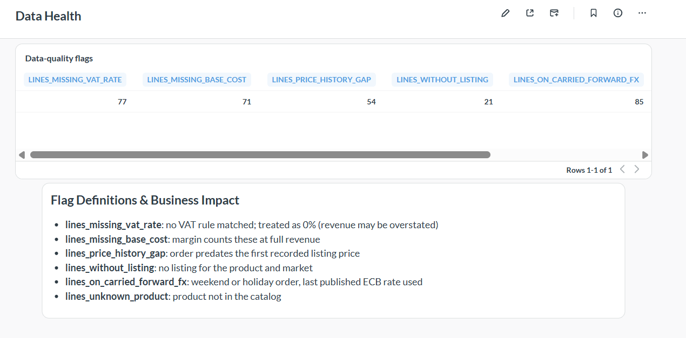

# BI layer: Metabase

Dashboards for ecommerce sales, financial performance, and data quality audits, built on the dbt marts in Snowflake. Amounts are in EUR, ex-VAT and after discounts.

> **Sample data:** 500 synthetic order lines across Germany, the United Kingdom, Switzerland and Poland, 1-25 March 2024. No real company data.


## Architecture

```
dbt marts (Snowflake, MARTS schema) --> rpt_order_items --> Metabase (Docker) --> dashboards
```

- `rpt_order_items` is a flat, tested dbt model (the fact joined to its dimensions), so dashboards need no joins.
- Metabase connects as `BI_USER` with the read-only role `BI_READER`, which can see the `MARTS` schema only ([`snowflake_bi_access.sql`](snowflake_bi_access.sql)).

## Run it

```powershell
cd bi
copy .env.example .env      # then set MB_DB_PASS
docker compose up -d
```

Open http://localhost:3000, complete the setup wizard, then add a Snowflake database with
`BI_USER` / role `BI_READER` / warehouse `COMPUTE_WH` / database `ECOMMERCE_DB` / schema `MARTS`.

## Sync dbt documentation to Metabase

Column descriptions, friendly names and semantic types are defined **in dbt** (`models/marts/marts_tests.yml`, under `meta`) and pushed to Metabase with [`dbt-metabase`](https://github.com/gouline/dbt-metabase). The data dictionary therefore lives in Git, and Metabase can be rebuilt from it.

| dbt `meta` key | What it sets in Metabase |
|---|---|
| `metabase.display_name` | friendly table or column name |
| `metabase.semantic_type` | field type (PK, Category, Currency, Quantity, Percentage) |
| `metabase.points_of_interest`, `metabase.caveats` | notes shown in the table information panel |

Descriptions come from the dbt `description` fields.

**One-time setup.** Use a separate virtual environment so it cannot disturb the pinned dbt versions:

```powershell
python -m venv venvs\dbt-metabase
.\venvs\dbt-metabase\Scripts\Activate.ps1
pip install dbt-metabase==1.6.1
```

**Each time the dbt docs or `meta` change:**

```powershell
# in the project's dbt environment
dbt parse

# in the dbt-metabase environment (credentials stay in this terminal session only)
$env:METABASE_USERNAME = "<metabase login email>"
$secure = Read-Host "Metabase password" -AsSecureString
$env:METABASE_PASSWORD = [System.Net.NetworkCredential]::new("", $secure).Password
.\bi\sync_metabase.ps1
```

The sync is idempotent, so it is safe to re-run. Currency formatting (the Euro symbol) is a Metabase display setting that is configured in the Metabase UI and is not managed by dbt.

## Dashboards

| Dashboard | Audience | Content |
|---|---|---|
| Ecommerce Sales & Financial Performance: Revenue, Margins & Trends (EUR) | leadership | net revenue, margin %, average order value, trend, country and category splits, price type mix. Filters: date, country, product category |
| Data Quality: Fallbacks & Missing Data | data team | counts of order lines that rely on a fallback (missing VAT rule, missing cost, price history gap, no listing, carried-forward FX rate, unknown product) |



## Metric definitions

| Metric | Definition |
|---|---|
| Net revenue | `(gross - discount) / (1 + VAT rate)` in EUR: ex-VAT, after discounts |
| Margin % | `sum(margin) / sum(net revenue)`, counting only lines with a known product cost |
| Average order value | net revenue divided by distinct orders |

These match the dbt semantic layer metrics (`net_revenue`, `margin_pct`, `average_order_value`).

## Reconciliation

The headline figures were checked against the warehouse and the semantic layer.

| Figure | Metabase | MetricFlow | Snowflake |
|---|---|---|---|
| Net revenue | 122,998.94 | 122,998.94 | 122,998.94 |
| Average order value | 476.74 | 476.74 | 476.74 |
| Margin % (known cost) | 37% | 0.37 | 0.37 |

## Limitations

- The free edition of Metabase stores dashboards in its own database, with no file export. This README, the screenshots and the SQL in [`metabase/`](metabase/) document them.
- After dbt changes columns, run Metabase's "Sync database schema now".
- Local development setup. Not hardened for production use.